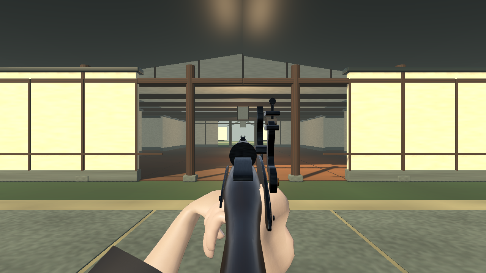

# Samurai with Muskets

A standalone Godot 4 first-person team deathmatch foundation. Select Samurai or Rōnin, fight in the Palace of Ash with a single-shot musket and a katana, die, respawn, and play through a score- or timer-ended match. Five combatants per side; nine autonomous bots fight the player and one another.

The rōnin faction uses the supplied full-quality skinned model and authored clips. First-person presentation now reuses its modeled arms and finger rig, with clean-barrel musket ADS and articulated reload handling. See [first-person combat and validation](docs/FIRST_PERSON.md) and [rōnin integration](docs/RONIN.md). Artist polish remains for grips, wrist/sleeve deformation, Samurai and environment art.

This is a functional gameplay prototype, **not finished character or environment art**. See [limitations](docs/TESTING.md).



## Play

[Current branch Windows build](dist/ASHIGARU-FirstPerson-Windows.zip) · [Historical overhaul footage (superseded sights)](dist/ASHIGARU-FirstPerson-Combat.mp4) · [Report](docs/FIRST_PERSON.md)

Previous main builds: [Windows](dist/SamuraiWithMuskets-Windows.zip) · [Linux](dist/SamuraiWithMuskets-Linux.zip). The first-person branch is prepared for review and is not merged into main.

Windows: extract the Windows ZIP and run `SamuraiWithMuskets.exe`. No Godot installation is required. The executable is unsigned. A native Windows run has not been tested in this Linux environment.

Linux: extract the Linux ZIP, `chmod +x SamuraiWithMuskets.x86_64`, and run it from a desktop session. Requires an OpenGL 3.3 compatible driver.

Source: install **Godot 4.6.3 Standard** (not .NET), import `project.godot`, then press F6 on `scenes/main.tscn`, or F5 to run the project. No plugins, packages, credentials, or Blender installation are needed to play. The supplied `.blend` sources are retained in `source_assets/`, excluded from Godot import; the game uses GLB versions.

1. Play → choose a faction → choose Standard or Quick → Enter the Courtyard.
2. Standard: 40 team kills or 8 minutes. Quick: 10 kills or 3 minutes.
3. Kills score for the attacker's team. Friendly fire causes no damage. Ties at the timer produce a draw.
4. Results offer Fight Again or Return to Menu. Escape pauses the match and releases the mouse.

| Control | Action |
|---|---|
| WASD | Move |
| Mouse | Look |
| Shift / Space | Sprint / Jump |
| Left Ctrl | Crouch / crouch movement |
| Caps Lock | Toggle auto-sprint |
| Left mouse | Fire / katana cut |
| Right mouse | Aim musket |
| Q or mouse wheel | Switch weapon |
| R | Reload musket |
| Escape | Pause / resume |

Musket: 100 damage, one loaded shot, 18 reserve cartridges, a full five-second reload. Reload begins automatically after firing and continues in the background. Katana: 55 damage, 2.7 m reach, 0.8-second cooldown. Reload continues while the katana is selected. Each combatant has 100 health and respawns after three seconds. Respawning restores equipment and grants three seconds of protection; attacking ends it. Settings persist in Godot's `user://settings.cfg`.

## Cloud development

Use this checkout directly. Cloud tasks are already isolated; do not create a worktree unless explicitly requested.

```bash
cd /workspace/ashigaru
./tools/setup.sh
./tools/test.sh
```

The helpers put writable Godot state in `/workspace/.runtime`. Set `ASHIGARU_RUNTIME_DIR` to another writable directory outside this project on other machines. A desktop display is required for interactive play and the two mouse-capture assertions. Headless test runs explicitly skip those two assertions. With a display, use `DISPLAY=:9 ./tools/test.sh` (or your existing display). The virtual Xorg display used during development is not required for normal desktop play. In this cloud environment, `./tools/virtual-display.sh` starts or checks display `:9`; then use `DISPLAY=:9 ./tools/test.sh`. Starting the display requires local Unix-socket permissions.

```bash
source tools/runtime.sh
godot --editor --path .
godot --path .
```

## Export

Install Godot's matching 4.6.3 Standard export templates using Editor → Manage Export Templates, or use the already installed templates in this cloud environment with `source tools/runtime.sh`.

```bash
mkdir -p builds/windows builds/linux
godot --headless --path . --export-release 'Windows Desktop'
godot --headless --path . --export-release Linux
```

Both presets embed the PCK for single-file desktop distribution and exclude source Blender files, tests, docs, and tools. Official export templates were verified against the release's SHA-512 list. Windows code signing and executable metadata editing are disabled; no platform SDK is needed.

## Layout and extension points

- `scenes/main.tscn`: application entry; `player.tscn` and `bot.tscn`: independently instanced actor roots.
- `PlayerController`, `BotController`: movement and actor decisions. Bots use collision-aware A* grid paths, obstruction rays, and the same weapons/damage as the player.
- `WeaponController`, `Musket`, `Katana`: input-independent attacks, ammunition, cooldowns, reload and weapon visuals.
- `HealthComponent`, `DamageSystem`: health, death signals, friendly-fire rules and world ray casts.
- `MatchManager`, `SpawnManager`: team scores, clock, match completion and separated faction spawn areas.
- `HUD`, `MainMenu`: presentation, faction selection, settings, pause and results.
- `Arena`, `Geometry`: replaceable courtyard geometry and provisional faction silhouettes. `Geometry.weapon` is the weapon model adapter.
- `SoundBank`: local/spatial audio. All included audio is original synthesized audio; see `LICENSES.md`.

No networking is implemented. Attack/damage and match state are separated from UI and input to make a later authoritative networking layer possible; the current code is not network-ready.

See [rōnin screenshots, footage and import report](docs/RONIN.md), [palace screenshots, navigation footage and performance report](docs/PALACE.md), [animation status and footage](docs/ANIMATION.md), [test evidence and limitations](docs/TESTING.md) and the original [project brief](docs/BRIEF.md).
