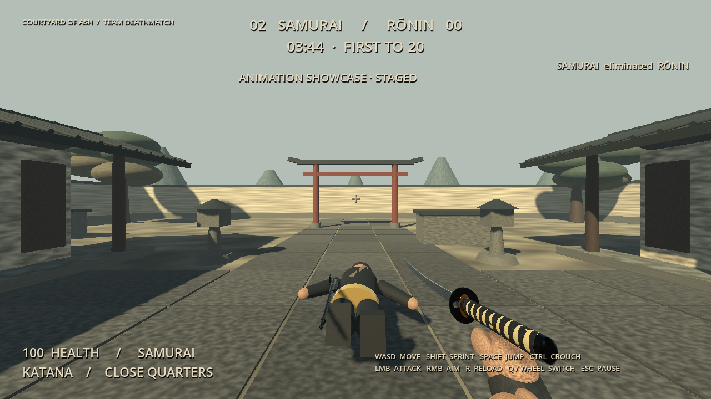

> Historical animation pass. The supplied rōnin asset has since been integrated; see [current rōnin report](RONIN.md).

# Animation and combat presentation pass

This update refines the existing project. The arena, navigation/target-selection logic, supplied musket and katana assets, and original audio files are preserved. No controller support or networking was added.

## Implemented

| State | Current presentation |
|---|---|
| Idle | Subtle breathing and torso movement |
| Walk | Alternating hip/knee gait, body bob and supported weapon stance |
| Sprint | Faster, longer-stride procedural pose; first-person weapon bob increases with running speed |
| Crouch / crouch walk | Blended body lowering, bent knees and reduced stride; player camera/capsule smoothly lower, movement slows, standing checks overhead clearance |
| Musket aim | Blended raised arms and supported weapon stance; existing first-person FOV/aim alignment preserved |
| Musket fire | Smoothed rearward recoil, pitch kick and third-person shoulder reaction; existing flash, smoke and sound preserved |
| Musket reload | Continuous weapon tilt/lower/return with supporting arm motion; **five-second automatic background reload**, including while the katana is equipped |
| Katana ready / attack | Raised ready stance, torso/arm swing and a smoothed first-person cutting arc |
| Weapon switch | Lower, exchange models near the bottom of the motion, then raise; attacks gated during the 0.36-second exchange |
| Hit | Short torso flinch, restrained player camera roll and damage tint; distinct melee/headshot/kill text with existing sound feedback |
| Death | Provisional 1.15-second fall with relaxed limbs and a settling weapon, followed by a visible body hold until the three-second respawn |

Headshots use a separate physical sphere around the head, above the body capsule. Traces identify the struck hitbox rather than inferring headshots from arbitrary hit height. Crouched head and body hitboxes follow the lowered pose. Existing musket/katana damage is unchanged; a headshot has distinct confirmation, not an additional damage multiplier.

Dead actors immediately stop locomotion and cannot attack. Their head/body combat colliders are disabled. The visual rig continues its death animation; the body is recycled only after the animation has finished and the respawn delay has elapsed. Player deaths also create a visible world-space body. Pausing pauses the death sequence. This is a controlled procedural fall, **not a physics ragdoll**; collisions against nearby scenery are not simulated for the corpse.

## Asset status / unfinished work

No completed Claude rōnin asset was found in the checkout or supplied attachments. Existing meshes remain **provisional articulated geometry**, not final character artwork. First-person hands/sleeves are also provisional, with separate musket and katana grip placements; there is no finger rig or hand IK. Detailed flintlock ramrod/powder handling, authored motion-capture clips, foot IK and collision-aware ragdolls remain unfinished.

`CharacterAnimator` owns presentation; `BotController` and `PlayerController` expose an optional `character_asset: PackedScene`. The adapter instances a supplied scene without rewriting its skeleton, materials, textures or tracks. Its `clip_map` maps idle/walk/sprint/crouch/crouch_walk/aim/fire/reload/katana_ready/katana_attack/hit/death to an imported AnimationPlayer with 0.18-second transitions. Imported death clips can extend body retention beyond the default delay. Once a real asset exists, clip names, scale, skeleton attachment/socket placement and visual alignment still require inspection and validation; integration of that absent asset is **not claimed**.

The procedural rig supports sprint and crouch-walk states. Current bots retain their original movement speed and navigation decisions; they crouch when stationary at range rather than gaining new sprint tactics.

## Validation and footage

The display-backed suite passes **52 checks** with zero failures or skips, including the original combat loop, five-second background reload, recoil/reload/switch/swing motion, crouch transitions, head/body hit classification, hit reaction, visible death completion, no attacks while dead, respawn, and a naturally score-ended bot match. See [testing details](TESTING.md) and [raw results](integration-output.txt).

[Watch/download the presentation footage](../dist/ASHIGARU-Animation-Presentation.mp4). It is a 24-second real Godot render with audio: the first 18 seconds are explicitly labeled **staged animation showcase** (walking, crouching, shooting/reloading, headshot death, katana and melee death); the final six seconds are a fresh **live match with autonomous bots**. This is automated capture, not a human playtest.

Updated Windows and Linux packages are in `dist/`. Native Windows execution remains untested in this Linux environment.
