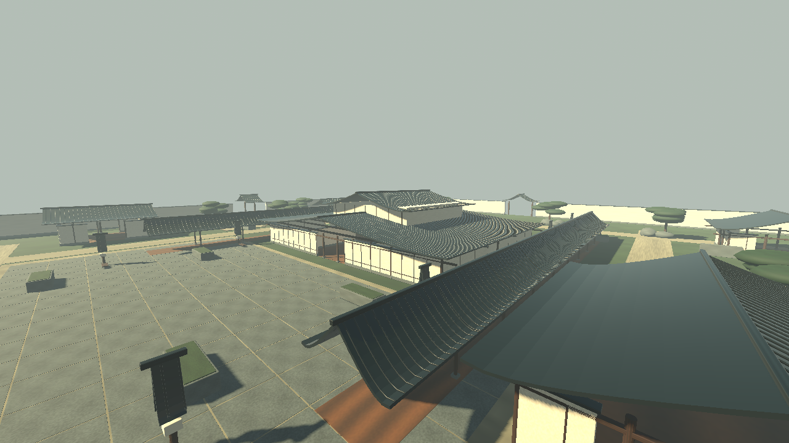
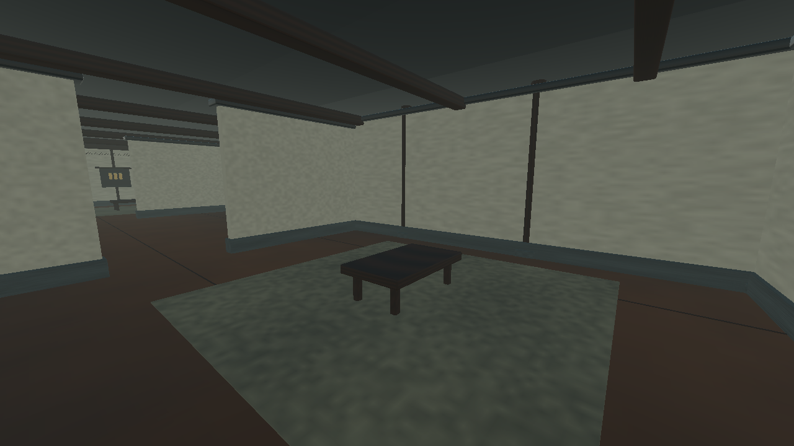
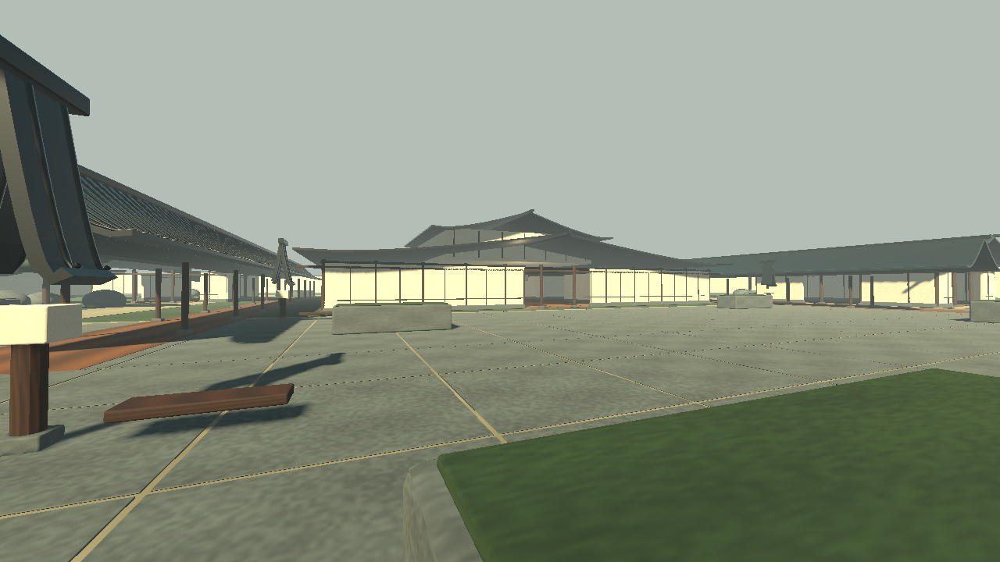
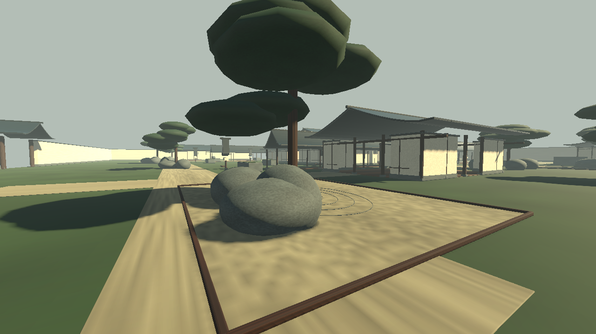

> Historical palace-map pass. The current character integration and latest validation are documented in [RONIN.md](RONIN.md).

# Palace of Ash — map overhaul

The canonical ASHIGARU project now uses a 150 × 150 metre fictional palace complex. This replaces the 40 × 40 metre courtyard in the same project and branch; no second game or repository was created.

## Battlefield

- A 44 × 32 metre central palace with four entrances, a broad processional hallway, connected side rooms, timber ceilings, room mats, writing tables, wall hangings and hanging lights.
- A substantial paved southern courtyard with planter cover and long musket lanes.
- Eastern and western pavilions, covered colonnades, exterior circuits and cross-garden routes connecting the palace entrances.
- Raked gravel gardens, shaped pine canopies, eroded rocks, timber edging, lanterns and seats.
- Defensive perimeter walls with four gates, and separate spawn lodges with sight baffles.
- Layered curved roofs, modeled ceramic ribs, beveled framing and original textured PBR materials. The upper roof/storey is architectural scenery, **not an accessible second floor**.

All environment meshes are original Blender-authored procedural modules. `source_assets/Palace.blend` retains the base modular source. `tools/build_palace.py` and `tools/optimize_palace.py` reproducibly construct, furnish, smooth and spatially batch the final asset. The runtime GLB is grouped into 185 material/spatial chunks for culling. Run both scripts with Blender, then `./tools/setup.sh` when rebuilding the environment art. No downloaded model, texture or sound pack was used.

## Navigation and tactics

A Godot navigation mesh is baked from static collision, excluding decorative roofs. Combatants use the existing deterministic A* routing approach, expanded to a 147 × 147 cell grid derived from the same collision layout. This is deliberately distinct from claiming that bots use NavigationAgent3D: their movement uses the shared grid, while the engine navmesh is also available for future agent integration.

Bots take varied palace approach lanes, traverse doors/rooms/galleries, choose nearby reachable cover that obstructs enemy sight while reloading, reposition between firing opportunities and use katanas at close range. Local separation reduces crowding. Enemy spawn zones are excluded from target acquisition and pursuit destinations; bots patrol toward the palace when all opponents are still inside their spawn zones. There is no global omniscient teleport/recovery mechanism.

The default roster is now **5v5** (one player and nine bots). Standard matches run to 40 kills or eight minutes; Quick matches run to ten kills or three minutes. Safe spawn selection favors slots far from combatants, with three seconds of damage protection. Firing or attacking ends that protection. Death animations, the three-second respawn delay, scoring, restart and results remain intact.

This checkout previously had 4v4, no spawn shield and no auto-sprint toggle. The pass supplies the requested 5v5, spawn protection and Caps Lock auto-sprint. It preserves the existing 100-damage musket and physical headshot indication; two-shot body damage was not previously implemented, so that conditional request did not change the weapon's damage. Five-second automatic background reload, katana damage/cooldown, crouch, weapon switching, models and existing audio remain.

## Audio

The original audio files are retained. Additional original synthesized wind/garden and interior ambience crossfade according to the player's location; wood, stone and soil have distinct footstep sounds. Existing positional weapon and melee audio is retained. All added sound generation uses noise/oscillator envelopes, not external recordings. See `LICENSES.md`.

## Evidence

[Combat/animation regression output](integration-output.txt): 52 checks, zero failures/skips in the display-backed run. [Palace output](palace-output.txt): 28 checks, zero failures. The palace suite also verifies production bots firing at an 18 metre encounter and switching to katanas at two metres. A normal spread miss is allowed by the ranged-fire assertion; spread is not disabled. The palace suite physically moves the player through rooms, hallways, both indoor/outdoor transitions and garden circuits using production collision. It also checks non-overlapping spawns, damage protection, auto-sprint movement, reachable sight-blocking cover and distinct approach routes.

The independent ten-combatant simulation finished a 11–12 match. All nine bots visited the actual central palace footprint; 32 reload-cover moves were selected. The evidence is a complete production-logic match, not merely import or navigation-path generation.

[Performance measurements](palace-performance.txt) report a real 1280×720 display run with ten active actors, warm-up and 300 measured frames. This cloud machine uses Mesa **llvmpipe software rendering**, not a gaming GPU. The final measured average was **5.01 FPS**, with a 196.5 ms median and 217.3 ms p95 frame time. This is not smooth real-time performance on this cloud CPU renderer. Draw calls fell from 2,124 in the first capture to 906 after batching, but Windows/gaming-GPU performance still requires a native test. These timings are not a Windows/GPU frame-rate promise. Weapon surfaces are batched by material without changing the original weapon assets, and the directional light uses a single shadow projection to reduce overhead.

[Watch/download live bot-navigation footage](../dist/ASHIGARU-Palace-Navigation.mp4). The 42-second bot-follow video (including a brief overview) is captured at a fixed 30 simulation frames per second (offline capture; not a performance benchmark). It observes the actual match using an obstruction-aware observer camera following live bots; the player is idle and nine bots run their production AI. No bot paths or kills are scripted for capture.

## Screenshots

## Known limitations

- Environment geometry and original textures are substantially developed, but this remains an authored prototype art pass rather than a finished photorealistic environment. Foliage, small props and material variation need further art work. Existing character and hand art remains provisional.
- Upper storeys/roofs are not playable, and no accessible elevated firing platform is delivered in this pass. All combat circulation is on one level.
- Collision is simplified for vegetation, small decorations and furniture; path following and local separation are not a full crowd simulation. The tests establish working routes and matches, not proof against every possible stuck/camping case.
- Spawn shields and AI spawn exclusions discourage camping; they do not make camping impossible for a human opponent.
- Surface footsteps and ambience are region-based, not physical acoustic propagation or per-triangle material detection.
- Native Windows execution and dedicated-GPU performance remain unverified. The Windows artifact is a release export, not a native Windows test result. The cloud software-rendered performance report should be read before assessing performance readiness.
